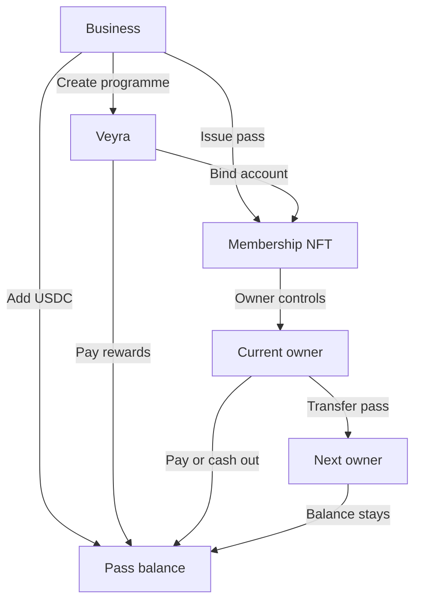
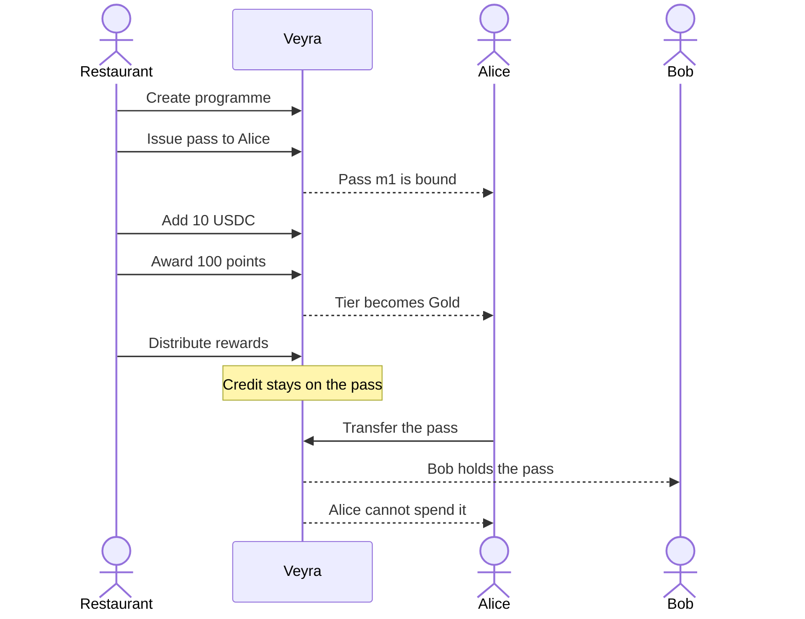

# Veyra: The infrastructure for programmable ownership.

Veyra is an open-source protocol for programmable membership NFTs. A membership owns an account, accumulates rewards, receives payments, and carries access rights. Transfer the NFT and the whole economic relationship moves with it. The previous owner loses control. The balance stays.

Built on NEAR's NFT and account infrastructure, Veyra connects digital ownership with real economic utility.

Businesses and developers use Veyra for transferable loyalty programmes, revenue-sharing memberships, subscription assets, and programmable community economies.

**Vision:** Turn NFTs from static digital assets into programmable economic relationships that users truly own.

## How it works

A programme is a set of tiers. The business picks a name, a symbol, and a brand color. Veyra draws the pass from that color. Issuing a membership mints a NEP-171 token and binds a deterministic account, `m{n}.{contract}`. Spendable value is mock USDC (mUSDC, 6 decimals), the same kind of test dollar used by Marks. It sits in a balance keyed by the token. Rewards and revenue credit the token, never a person's wallet. Paying or cashing out sends mUSDC to whoever the current owner approves. Transfer the NFT and the balance moves with it.



Transfer is the part that has to be right. Approvals are cleared in the same call. A payout cannot be redirected to the previous owner, because the credit names the token. If `nft_transfer_call` reverts, ownership returns and the vault does not move.



## Repository

```text
.env                  shared configuration, not committed
.env.example          the variables both sides read
brand.md              color, type, and voice
contract/             NEAR Rust protocol
token/                Veyra mock USDC, mUSDC, 6 decimals
web/                  Next.js business, member, overview, and explorer UI
```

`contract/` and `web/` do not keep their own env files. Copy `.env.example` to `.env` at the root. The web app reads that file. Deploy commands in this README use the same names.

```bash
cp .env.example .env
```

| Variable | Purpose |
|---|---|
| `NEAR_NETWORK_ID` | `testnet`, `mainnet`, or `local` |
| `NEAR_NODE_URL` | RPC endpoint |
| `NEAR_CONTRACT_ID` | Account the wasm is deployed to. The web reads and writes this contract |
| `NEAR_PROTOCOL_OWNER` | Account that calls `new` after deploy |
| `NEAR_USDC_TOKEN` | Mock USDC account. Pass balances and pools use this token |

## Contract plan

`contract/` is a NEP-171 contract with Veyra state beside the token: programmes, tiers, memberships, vaults, and history.

Custody is intentional. The bound account id is the membership's public address. The spendable balance is a vault on the protocol, not a key sitting in the previous owner's wallet. That is what makes transfer atomic. Creating a sub-account and handing out a full-access key would let the old key race a payout. This design does not do that.

The contract is the source of truth. The web reads it over RPC and sends every change through the signed-in wallet. `contract/src/lib.rs` holds the state and init. Programme, membership, economy, access, and NEP-171 methods live in their own files and are included from there. Shared checks live in `internal.rs`.

### Build and test

```bash
cd contract
cargo test
```

`cargo test` runs the Harbour Club demo end to end: issue, bind, fund, award, gift, revoke, reward, revenue, access checks, approve, revoke, pause, transfer, and withdraw. Separate tests cover the failed paths: previous owner withdraw, cleared approval, paused programme, empty pools, cross-programme gifts, tier removal, self-transfer, threshold changes, and a reverted `nft_transfer_call` that leaves the vault in place.

Release wasm, after [cargo-near](https://github.com/near/cargo-near) is installed:

```bash
cd contract
cargo near build
```

Deploy against the root env:

```bash
set -a && source .env && set +a
near contract deploy "$NEAR_CONTRACT_ID" use-file contract/target/near/veyra.wasm
near contract call-function as-transaction "$NEAR_CONTRACT_ID" new_default_meta \
  json-args "{\"owner_id\":\"$NEAR_PROTOCOL_OWNER\"}" \
  prepaid-gas '30.0 Tgas' attached-deposit '0 NEAR' sign-as "$NEAR_PROTOCOL_OWNER"
```

## Web plan

`web/` is the operator and member interface.

| Route | Who it is for | What it does |
|---|---|---|
| `/` | Anyone | Positioning and the way into the product |
| `/overview` | Anyone | Every programme and pass currently on the contract |
| `/business` | Programme owner | Create a programme, issue a pass or a claim link, add mUSDC, request a payment |
| `/member` | Holder | The pass, its mUSDC balance, scan-to-pay, cash out, and transfer |
| `/claim/[id]` | The customer | Scan or open a claim link. The code clears once the pass is minted |
| `/explorer` | Anyone | Look up one pass by token id or bound account |

Sign-in uses the same NEAR connector as Marks: a passkey, a NEAR wallet, or an EVM wallet. Views come from `NEAR_NODE_URL`. Writes are wallet transactions to `NEAR_CONTRACT_ID`. There is no local demo ledger.

```bash
cd web
npm install
npm test
npm run dev
```

To deploy the protocol and the mock USDC token, then call the methods on testnet:

```bash
cd contract && cargo build --release --target wasm32-unknown-unknown
cd ../token && cargo build --release --target wasm32-unknown-unknown
cd ../scripts && npm install && node exercise.mjs
```

The script creates the protocol accounts and a mock USDC account, deploys both wasms, and writes `NEAR_CONTRACT_ID` and `NEAR_USDC_TOKEN` into the root `.env`. Keys stay in `.keys/`, which is gitignored. Restart the web app after that so it picks up both accounts.

Open [http://localhost:3010](http://localhost:3010).

## Functions

Chain methods use `snake_case`. Payable methods take a storage deposit so the contract can pay for the new state. Spendable value on a pass is mock USDC: amounts are `U128` strings with 6 decimals, so `10000000` is 10 mUSDC. The older NEAR vault methods are still on the contract. The product uses mUSDC, because a dollar amount is easier to read than yoctoNEAR.

A programme id and each tier id are generated in the web app. The owner types a name, a symbol, a brand color, and the tiers. The color is drawn into a pass image and stored as the programme media. Revenue share is a percent in the form. The contract stores basis points, so 10% is `1000`.

### Protocol

| Method | Payable | Who | Effect |
|---|---|---|---|
| `new` | | deploy account | Init with NFT metadata |
| `new_default_meta` | | deploy account | Init as Veyra / VEYRA |
| `get_protocol_owner` | | anyone | Protocol admin account |
| `nft_metadata` | | anyone | NEP-177 contract metadata |
| `get_accounting` | | anyone | Programmes, memberships, pools, vaults |

### Programmes

| Method | Payable | Who | Effect |
|---|---|---|---|
| `create_program` | yes | caller becomes owner | Id, name, symbol, tiers. One tier must start at 0 XP |
| `update_program` | | owner | Name and symbol |
| `set_program_color` | yes | owner | Brand color. The web draws the pass from it |
| `set_program_media` | yes | owner | Picture address copied onto every pass in the programme |
| `pause_program` | | owner | Stops issue, points, funding, and distribution. Transfer, pay, and withdraw still work |
| `resume_program` | | owner | Clears the pause |
| `configure_tiers` | yes | owner | Replace tiers. Occupied tiers cannot be removed. Members are re-tiered from XP |
| `get_program` | | anyone | One programme |
| `list_programs` | | anyone | Page of programmes |
| `get_program_history` | | anyone | Programme activity |
| `fund_rewards` | yes | owner | Attached NEAR joins the NEAR reward pool. The product funds rewards with mUSDC instead |
| `record_revenue` | yes | owner | Attached NEAR joins the NEAR revenue pool. The product records revenue in mUSDC |
| `distribute_revenue` | | owner | Split the NEAR pool by tier basis points, then evenly across members of that tier. Dust stays in the pool |

### Memberships

| Method | Payable | Who | Effect |
|---|---|---|---|
| `issue_membership` | yes | owner | Mint NEP-171 to an account, open a membership, bind the account |
| `open_claim` | yes | owner | Open a one-time claim link. The code clears when it is used |
| `claim_membership` | yes | the claimant | Mint the pass to the account that submits the claim |
| `get_claim` | | anyone | Claim still open, or nothing if it has been used |
| `bind_account` | | owner | Set `m{n}.{contract}` once. Later calls return the same account |
| `get_membership` | | anyone | Membership, tier, vault, rights, picture |
| `find_membership` | | anyone | Resolve a token id or the pass account |
| `memberships_for_owner` | | anyone | What an account holds |
| `memberships_for_program` | | anyone | What a programme has issued |
| `list_memberships` | | anyone | Page across programmes |
| `transfer_membership` | 1 yocto | owner or approved | `nft_transfer` plus the Veyra bookkeeping |

### Accounts and value

| Method | Payable | Who | Effect |
|---|---|---|---|
| `get_account` | | anyone | Bound account, controller, vault |
| `fund_membership` | yes | anyone | Attached NEAR credits the NEAR vault. The product adds mUSDC with `ft_transfer_call` |
| `withdraw` | 1 yocto | current owner | Pay the NEAR vault out to the current owner. Cashing out mUSDC uses `cash_out` |
| `pay` | 1 yocto | current owner | Debit mock USDC from the pass and send it to another account. The pass stays |
| `cash_out` | 1 yocto | current owner | Send mock USDC from the pass to the current owner |
| `ft_on_transfer` | | mock USDC token | Credit a pass (`vault:<id>`), the reward pool (`rewards:<programme>`), or revenue (`revenue:<programme>`) |
| `set_usdc_token` | | protocol owner | The mUSDC account this protocol accepts |
| `distribute_usdc_reward` | | owner | Move mUSDC from the reward pool into one pass |
| `distribute_usdc_revenue` | | owner | Split the mUSDC revenue pool by each tier's percent |
| `award_points` | | owner | Add points and XP. XP can promote the tier |
| `revoke_points` | | owner | Remove points and XP. XP can demote the tier |
| `gift_points` | | current owner | Move points to another membership in the same programme. XP stays, so tier does not follow the gift |
| `distribute_reward` | | owner | Move NEAR from the reward pool into one membership vault |

### Access

| Method | Who | Effect |
|---|---|---|
| `verify_membership` | anyone | Does this owner hold the programme, and optionally this right |
| `check_access` | anyone | Does this token's tier include the right |
| `get_access_rights` | anyone | Rights on the token's current tier |

A paused programme fails closed on access checks. It does not trap the vault.

### History

| Method | Effect |
|---|---|
| `get_membership_history` | Issued, bound, funded, points, tier changes, rewards, revenue, transfer, pay, withdraw |

### NEP-171

| Method | Payable | Notes |
|---|---|---|
| `nft_transfer` | 1 yocto | Clears approvals, then records the transfer against the token |
| `nft_transfer_call` | 1 yocto | Same move, then the receiver callback. A revert restores the owner and leaves the vault |
| `nft_resolve_transfer` | | Private callback |
| `nft_approve` | storage | Owner approves an operator |
| `nft_revoke` | 1 yocto | Drop one approval |
| `nft_revoke_all` | 1 yocto | Drop every approval |
| `nft_is_approved` | | View |
| `nft_token` | | View |
| `nft_total_supply` | | View |
| `nft_tokens` | | View |
| `nft_supply_for_owner` | | View |
| `nft_tokens_for_owner` | | View |

There is no public `nft_mint`. Memberships are issued through `issue_membership`, so a token cannot exist without a programme, a tier, and a bound account.

## Demo script

The contract test `killer_demo_transfers_the_economic_relationship` still walks the NEAR vault: issue, points, gift, NEAR reward, NEAR revenue, transfer, and withdraw. `pass_image_is_issued_and_payment_debits_the_vault` is the mUSDC path. `scripts/exercise.mjs` runs both on testnet.

What a person does in the app:

1. Sign in. On Business, claim 1,000 mUSDC from the faucet. That registers the account on the token and is the test dollar used everywhere below.
2. Create a programme. The id is generated. Type a name, a symbol, and a brand color. Add tiers with a name, the points required, a revenue-share percent, and access rights. The first tier stays at 0 points. The app draws the pass and stores that image.
3. The programme appears under the programmes this account owns.
4. Issue a pass to a member account, or create a claim link. The link is also a QR. The customer opens it, signs, and the pass is minted to them. The QR clears once the claim is gone.
5. Add mUSDC to that pass, or to the reward pool, or record it as revenue. This is the moment real test value moves. It is not attached NEAR.
6. Award points. A member who crosses a tier threshold moves up and keeps the new access rights.
7. Distribute a reward into one pass, or split recorded revenue by each tier's percent.
8. On Business, enter an amount and show the payment QR. On Member, the holder scans it and confirms. The pass stays. That much mUSDC leaves the pass and is sent to the business account.
9. Transfer the pass and the remaining balance, the tier, and the access rights move with it. The previous owner cannot cash out.

## What this is not

Veyra is not a port of the Solana Verxio contracts, and it is not a second NFT standard. NEP-171 remains the ownership standard. Veyra is the behaviour on top: programmes, accounts, rewards, rights, and transfer-safe custody.
